# Popgen tutorial

This tutorial will guide you through some of the most common population genetics analyses.

The data we will use in this tutorial was simulated based on five fictional populations, which has been processed to generate alignments and genotypes, using the map_and_call pipeline. To follow along from the very beginning, see the [map and call pipeline tutorial](https://github.com/axeljen/mapcall_tutorial).

If you've run this previous tutorial, you are of course very welcome to directly use the output from that tutorial. Otherwise, we'll download the output data here, so also fine to just start from here.


## Get started

First, make a directory in which you want to run this tutorial and navigate into it:


    mkdir popgen_tutorial
    cd popgen_tutorial

Then you can clone this repo if you want to to have this readme file directly available to follow along:

```bash
    git clone https://github.com/axeljen/popgen_tutorial.git

    # download the archived data folder
    curl -L https://osf.io/download/rzmp9/ -o data.tar
    # and unpack it
    tar -xvf data.tar

    # remove the archive
    rm data.tar
```

Let's have a look at what's inside the data folder:

```bash
    ml tree # on dardel, we need to load tree as a module. if elsewhere, it might be available directly, but otherwise you can just skip this part.
    tree -d data -L 2
```
Should look something like this:

    data
    ├── map_and_call_out_downsample
    │   ├── 00_input_data
    │   ├── 01_reports
    │   ├── 02_bamfiles
    │   └── 03_genotypes
    ├── map_and_call_out_downsample_rescale
    │   ├── 00_input_data
    │   ├── 01_reports
    │   ├── 02_bamfiles
    │   └── 03_genotypes
    └── map_and_call_out_standard
        ├── 00_input_data
        ├── 01_reports
        ├── 02_bamfiles
        └── 03_genotypes

This data dir contains three toy example outputs from the [mapping and variant calling pipeline](https://github.com/axeljen/map_and_call). We'll explore these, and the differences among them, a bit more below, but we'll start with just focussing on the map_and_call_out_standard directory. Let's have a look at its content:

```bash
    tree -d data/map_and_call_out_standard -L 2
```
    data/map_and_call_out_standard
    ├── 00_input_data
    │   └── 00_reference_genome
    ├── 01_reports
    │   ├── 00_fastqc
    │   ├── 01_qualimap
    │   ├── 02_variantstats
    │   └── 03_damage_profiles
    ├── 02_bamfiles
    │   ├── dedup_metrics
    │   └── mapping_depths
    └── 03_genotypes
        ├── 00_raw_variants
        ├── 01_filtered_variants
        └── 02_maskfiles

Where:
- `00_input_data/00_reference_genome` contains the reference genome for the analysis.
- `01_reports` contains quality control and variant statistics reports.
- `02_bamfiles` contains the aligned BAM files along with deduplication metrics and mapping depths.
- `03_genotypes` contains the raw and filtered variant calls as well as mask files, defining regions in the genome where reliable genotype calls can be made.

If you don't have tree installed, you can install it, for example, with conda/mamba. 

We'll use conda in this tutorial to handle all installations. If [conda](https://docs.conda.io/en/latest/miniconda.html) is not installed, please install it first. If you're on dardel, you can just load conda as a module `ml PDC miniconda3`. Once you're ready to go, let's create an environment that we can add packages to:

```bash
    # let's create an environment
    conda create -n popgen_tutorial_env
    # it'll ask you for where to install the environment. By default, this will be in your home directory under .conda/envs. For now this is fine, but know that conda tends to generate lots and lots and lots of files, so when you're creating big things later on, you'll probably want to change this to a location where you have a solid allocation.

    # this will create a virtual environment, where we can install programs as we go.
    
    # to activate that virtual environment, go:
    conda activate popgen_tutorial_env
    # if you're using the dardel module, you'll have to run source instead:
    source activate popgen_tutorial_env
    
```

## Principal components analysis (PCA)

Now that we've got everything set up, let's start with running a PCA on our genotype data. 

### Using Plink

In this tutorial, we're only using simulated data resembling modern, high coverage sequencing data. When this is the case, we can be pretty confident in our genotype calls in the vcf file, so we can use the genotypes, or specifically the single nucleotide polymorphisms (SNP), in the vcf as input for running the pca. A popular program for running PCA on SNP data is plink. Let's move into the folder 1.1_pca_with_plink, and work inside that folder for this part.

```bash
    # go into subdir
    cd 1.1_pca_with_plink

    # for this part, we'll need plink (specifically plink2) to be installed, let's add that to our virtual environment
    conda install bioconda::plink2
    # this installs plink2 in the popgen_tutoral_env (it'll ask you to proceed so you'll need to confirm by typing 'y' when prompted.) Once installed, plink2 will be available to use as long as we have the popgen_tutorial_env activated

```

Plink requires a bit of preparation before we can run the actual PCA. Have a look at the `prepare_plink_input.sh` script. First, you'll see the vcf=$1 and outname=$2 lines, this is called command line arguments, and allows us to dynamically provide the input VCF file and the output prefix when running the script, meaning it would be executed as `bash prepare_plink_input.sh <input.vcf> <output_prefix>`:

This will take `input.vcf` as the input file and generate Plink files with the prefix `output_prefix`. 

After these lines, you'll see a bunch of variable assignments that define the filtering parameters that plink will apply to our data when prepping the input. These include thresholds for missing data per individual and per SNP, the minimum minor allele frequency, and the linkage disequilibrium pruning threshold. Adjusting these parameters allows you to control the quality and characteristics of the dataset that will be used for the PCA. They are currently set at quite reasonable and commonly used values, so you probably don't need to worry about this right now, but you can always play around with them and see how they affect your results.

So let's find the relative path to the vcf file to use, and run the script:

```bash
    # So the vcf file that we'll use is located in the ../data/03_genotypes/01_filtered_variants directory
    # let's check the content of this dir
    find ../data/map_and_call_out_standard/03_genotypes/01_filtered_variants

        # ../data/map_and_call_out_standard/03_genotypes/01_filtered_variants
        # ../data/map_and_call_out_standard/03_genotypes/01_filtered_variants/filtered_indels.vcf.gz
        # ../data/map_and_call_out_standard/03_genotypes/01_filtered_variants/filtered_indels.vcf.gz.csi
        # ../data/map_and_call_out_standard/03_genotypes/01_filtered_variants/filtered_snps.vcf.gz.csi
        # ../data/map_and_call_out_standard/03_genotypes/01_filtered_variants/filtered_snps.vcf.gz
    # the last one, ../data/map_and_call_out_standard/03_genotypes/01_filtered_variants/filtered_snps.vcf.gz is the one we want to use. Let's run the prepper script:

    # let's make a separate directory for this particular output, to keep it tidy
    mkdir -p pca_std_filt
    bash prepare_plink_input.sh ../data/map_and_call_out_standard/03_genotypes/01_filtered_variants/filtered_snps.vcf.gz pca_std_filt/pca_data_std_filt

```

Plink has a lot of different filtering and parsing parameters available, and there's quite a few of them that we need to use and a whole bunch that we probable best use too. In the script above, the command that generates the output files looks like this:

    plink2 \
        --vcf $vcf \
        --allow-extra-chr \
        --set-all-var-ids '@:#:$r:$a' \
        --snps-only just-acgt \
        --max-alleles 2 \
        --mind $missing_ind \
        --geno $missing_snp \
        --maf $minor_allele_freq \
        --make-pgen \
        --rm-dup exclude-all \
        --out $outname

To break this down a bit:
plink2 is the actual command, and then follows one parameter per line. Using the backslash at the end of each line allows the command to continue onto the next line, making it more readable. If we would have omitted the backslash at the end of each line and still written the command across multiple line, it would've failed.

`--vcf $vcf`
 specifies the input VCF file that Plink will use. The `$vcf` variable is set to the first command line argument when running the `prepare_plink_input.sh` script.

`--allow-extra-chr`
allows Plink to handle chromosomes that are not part of the standard set (1-22, X, Y, MT). This is useful if your VCF contains additional contigs or scaffolds.

`--set-all-var-ids '@:#:$r:$a'`
sets a unique identifier for each variant based on its chromosome, position, reference allele, and alternate allele.

`--snps-only just-acgt`
ensures that only SNPs with standard nucleotide alleles (A, C, G, T) are considered.

`--max-alleles 2`
restricts the analysis to biallelic variants only.

`--mind $missing_ind`
filters out individuals with a missing genotype rate higher than the specified threshold. the variable $missing_ind is defined at the beginning of the script and can be adjusted as needed. 30 % missing data per individual (as used here) is quite lenient, and we're applying this here since we're analyzing a mixture between modern and historical samples, where the historical samples will have a lot more missing data than the moderns and a strictere filter would remove too many of them. In a real world situation, we would want to explore different sets of filters and ensure that missing data is handled appropriately.

`--geno $missing_snp`
filters out SNPs with a missing genotype rate higher than the specified threshold. The variable $missing_snp is defined at the beginning of the script and can be adjusted as needed. 20 % missing data per SNP (as used here) is, as above, quite lenient, and in reality we might want to try different thresholds to explore how it affects our results.

`--maf $minor_allele_freq`
filters out SNPs with a minor allele frequency below the specified threshold. The variable $minor_allele_freq is defined at the beginning of the script and can be adjusted as needed. A common choice is 0.05, also used here, meaning that SNPs with a minor allele frequency below 5% will be excluded.

`--make-pgen`
tells Plink to generate the binary PED files (.pgen, .pvar, .psam) as output.
<!-- 
`--indep-pairwise 50 5 $linkage_pruning_threshold`
performs linkage disequilibrium pruning to remove highly correlated SNPs. The parameters `50 5 $linkage_pruning_threshold` specify the window size, step size, and r^2 threshold for pruning, respectively. The variable `$linkage_pruning_threshold` is defined at the beginning of the script and can be adjusted as needed.

`--bad-ld`
This flag is necessary if using the `--indep-pairwise` command on datasets wuth fewer than 50 individuals, just telling plink to ignore the fact that we're probably getting quite bad ld estimates here to base the pruning on. An alternative is to thin the dataset with physical distance instead, for example with vcftools, prior to running plink. -->

`--rm-dup exclude-all`
removes duplicate variants from the analysis. Duplicate variants can remain in the dataset after decomposing multiallelic sites, and plink will throw an error if this is the case unless this flag is used.

`--freq`
tells Plink to calculate allele frequencies for the SNPs in the dataset. The output will be written to a file with the `.afreq` extension, which can be used in subsequent analyses, such as PCA. This is required if the number of samples in the data is less than 50, otherwise plink will estimate allele frequencies on the fly.

`--out $outname`
specifies the prefix for the output files.

So, all the output files from this command will be prefixed with the value specified by the `--out` option, which in this case is `$outname`. So to move on to the actual pca, we can just use this prefix when referring to the Plink files in the subsequent steps.


```bash

    bash plink_pca.sh pca_std_filt/pca_data_std_filt

```

This will create three additional files:

    pca_std_filt/pca_data_std_filt_pca.eigenval
    pca_std_filt/pca_data_std_filt_pca.eigenvec
    pca_std_filt/pca_data_std_filt_pca.log

- The `.eigenval` file contains the eigenvalues, which indicate the amount of variance explained by each principal component.
- The `.eigenvec` file contains the eigenvectors, which represent the principal components for each individual.
- The `.log` file contains the log of the PCA computation, including any warnings or errors encountered during the analysis.

Let's visualize the first two principal components using a simple scatter plot in R:

```bash

    # to be able to plot this with R, we need R and the R-package tidyverse installed. If it isn't, install to our environment with conda:
    conda install -c conda-forge r-base r-tidyverse r-ggrepel

    # then, we can use the plot_pca.R script:
    Rscript plot_pca.R pca_std_filt/pca_data_std_filt_pca

```

This will produce two plots: `pca_std_filt/pca_data_std_filt_pca_pca_plot.png` and `pca_std_filt/pca_data_std_filt_pca_eigenval_bar_plot.png`

Inspect the plots, they should look something like this:

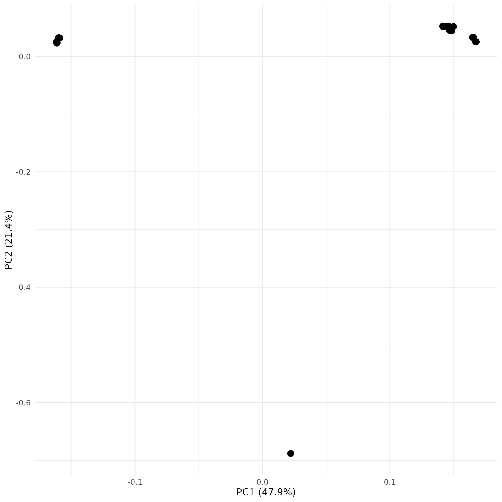
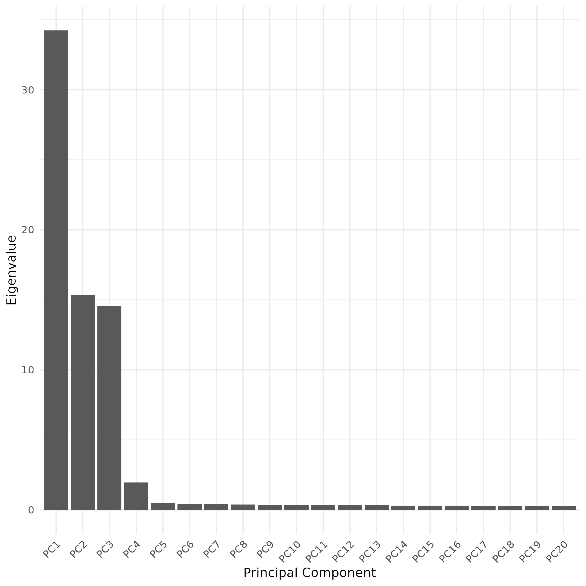

The first plot is the actual PCA. Each point in the scatter plot represents an individual, positioned according to their scores on the first two principal components. The second plot shows the eigenvalues, which indicate the amount of variance explained by each principal component.

1) What do you observe in the PCA plot? Are there any distinct clusters of individuals? How many populations would you say that there are based on this?

2) From the eigenvalues, do you think it makes sense that we extract the first two principal components and plot those?


To make things a little bit clearer, we can color the points in the PCA plot by the population they belong to. For this, we'll need a population assignment file, just listing one sample per line, and what population they were sampled from. Together with the data in this tutorial such a file was included, named sample_metadata.tsv. This file contains three columns, sequencing_id, original_id and population. Sequencing_id was only used for the mapping and variant calling step, so we can ignore that for now. Let's subset the sample_metadata.tsv file to only include the two last columns, remove the header line, and put that in a new file:

```bash
# use cut to extract the first and second column of the sample metadata table, and only save one row per sample
cut -f1,2 ../sample_metadata.tsv | uniq > ../data/sample_popfile.tsv
```

The `plot_pca.R` script was written to optionally take a populatiion file like this as input, and color the points in the PCA plot according to the population each individual belongs to. So let's rerun with the population file:

```bash
Rscript plot_pca.R pca_std_filt/pca_data_std_filt_pca ../data/sample_popfile.tsv
```

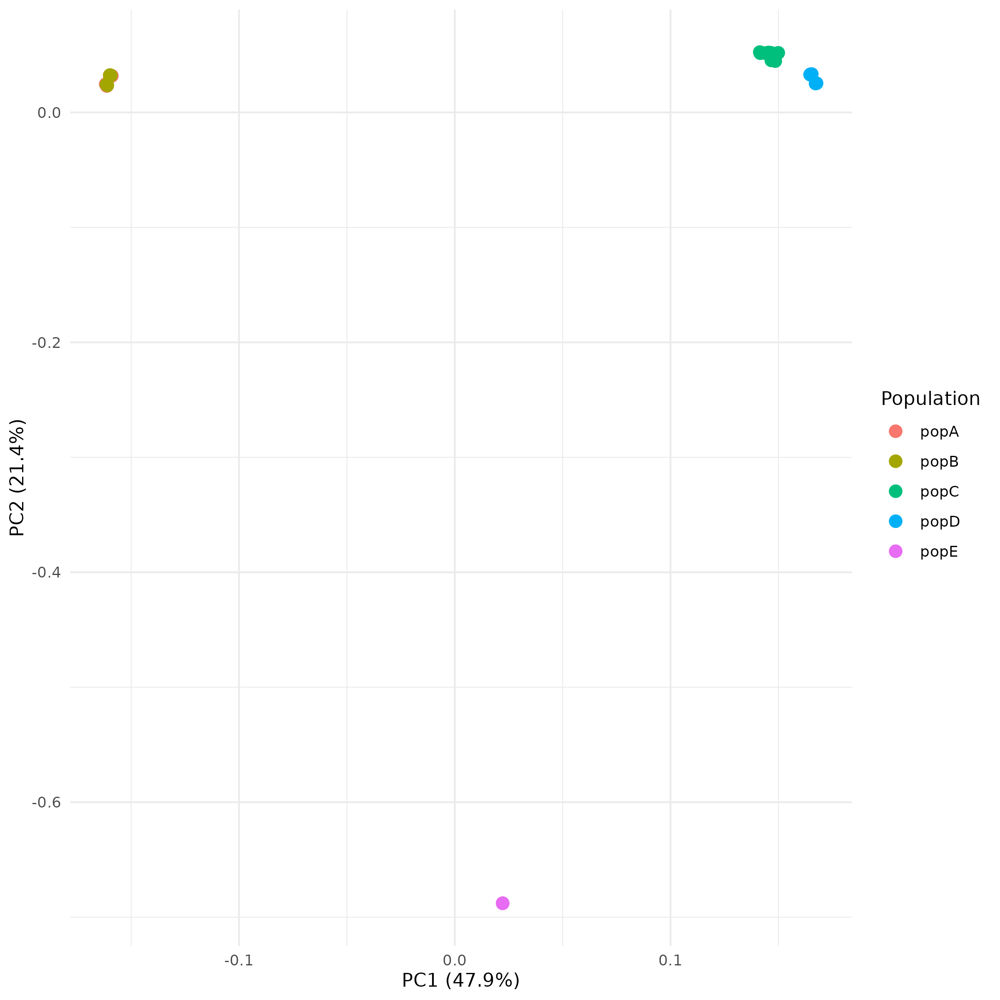

3) Did coloring the points by population help you to better distinguish the different clusters? Any new insights compared to the uncolored PCA plot?

As you can see, PopE differentiates massively from the other populations. This is expected since popE was actually simulated as an outgroup, so it is indeed the most distant relative to all other populations. Let's consider PopA-PopD our focal populations, and make another pca only including these populations.

```bash

# make a directory for storing files related to this subset analysis
mkdir -p pca_ABCD_pops

# extract a list of the samples to include
cat ../data/sample_popfile.tsv | awk ' $2 == "popA" || $2 == "popB" || $2 == "popC" || $2 == "popD" {print $1}' > pca_ABCD_pops/ABCD_samples_to_include.txt

# then we can simply pass this list to plink with the --keep flag, so let's copy the plink prepping script and add that argument
cp prepare_plink_input.sh prepare_plink_input_subset.sh

```

Awk is a powerful text/table processing tool that allows you to filter, manipulate, and extract specific columns from text files. In this case, we use it to filter rows in the sample_popfile.tsv file based on column 2 ($2), which contains the population information. The '||' operator represents a logical OR, so the condition '$2 == "popA" || $2 == "popB" || $2 == "popC" || $2 == "popD"' tells awk to only keep rows where **any** of these conditions are true, i.e., where the individual belongs to one of the specified populations. The '{print $1}' part tells awk to output only the first column, which contains the sample IDs, and redirect them to the file pca_ABCD_pops/ABCD_samples_to_include.txt.

Edit the `prepare_plink_input_subset.sh` script to include the `--keep` flag with the list of samples to look something like:


    # take the vcf file as first argument
    vcf=$1

    # and a prefix name for the plink files as second argument
    outname=$2

    # list of samples to keep
    samples=$3

    ## filtering parameters
    missing_ind=0.30 # minimum individual missingness threshold, i.e., individuals with more than 10% missing genotypes will be excluded
    missing_snp=0.20 # minimum SNP missingness threshold, i.e., SNPs with more than 20% missing genotypes will be excluded
    minor_allele_freq=0.05 # minimum minor allele frequency threshold, i.e., SNPs with a minor allele frequency below 5% will be excluded
    # linkage_pruning_threshold=0.2 # threshold for linkage disequilibrium pruning, i.e., SNPs with an r^2 value above this threshold will be pruned
    plink2 \
        --vcf $vcf \
        --allow-extra-chr \
        --set-all-var-ids '@:#:$r:$a' \
        --snps-only just-acgt \
        --max-alleles 2 \
        --mind $missing_ind \
        --geno $missing_snp \
        --maf $minor_allele_freq \
        --make-pgen \
        --rm-dup exclude-all \
        --freq \
        --keep $samples \
        --out $outname

And then prepare a new set of pca input files:

```bash
bash prepare_plink_input_subset.sh ../data/map_and_call_out_standard/03_genotypes/01_filtered_variants/filtered_snps.vcf.gz pca_ABCD_pops/pca_data_ABCD_pops pca_ABCD_pops/ABCD_samples_to_include.txt

# run the pca
bash plink_pca.sh pca_ABCD_pops/pca_data_ABCD_pops

# make a subset population map and plot
cat ../data/sample_popfile.tsv | awk ' $2 == "popA" || $2 == "popB" || $2 == "popC" || $2 == "popD" ' > pca_ABCD_pops/ABCD_sample_popfile.tsv
Rscript plot_pca.R pca_ABCD_pops/pca_data_ABCD_pops_pca pca_ABCD_pops/ABCD_sample_popfile.tsv

```
This is what that plot looks like:


Getting rid of the outgroup gives, at this level, three distinct clusters, where A and B sits more ore less indistinguishable from each other, while C and D form their own separate clusters. Let's make another one with only A and B, too:

```bash

mkdir -p pca_AB_pops

cat ../data/sample_popfile.tsv | awk ' $2 == "popA" || $2 == "popB" ' | cut -f 1 > pca_AB_pops/AB_samples_to_include.txt

# we can use the same subset script as before to prepare the input files for just these two populations, just providing the appropriate sample list as argument
bash prepare_plink_input_subset.sh ../data/map_and_call_out_standard/03_genotypes/01_filtered_variants/filtered_snps.vcf.gz pca_AB_pops/pca_data_AB_pops pca_AB_pops/AB_samples_to_include.txt

# run the PCA on the prepared input files
bash plink_pca.sh pca_AB_pops/pca_data_AB_pops

# create a new population assignment file again before plotting
cat ../data/sample_popfile.tsv | awk ' $2 == "popA" || $2 == "popB" ' > pca_AB_pops/AB_sample_popfile.tsv

Rscript plot_pca.R pca_AB_pops/pca_data_AB_pops_pca pca_AB_pops/AB_sample_popfile.tsv


```

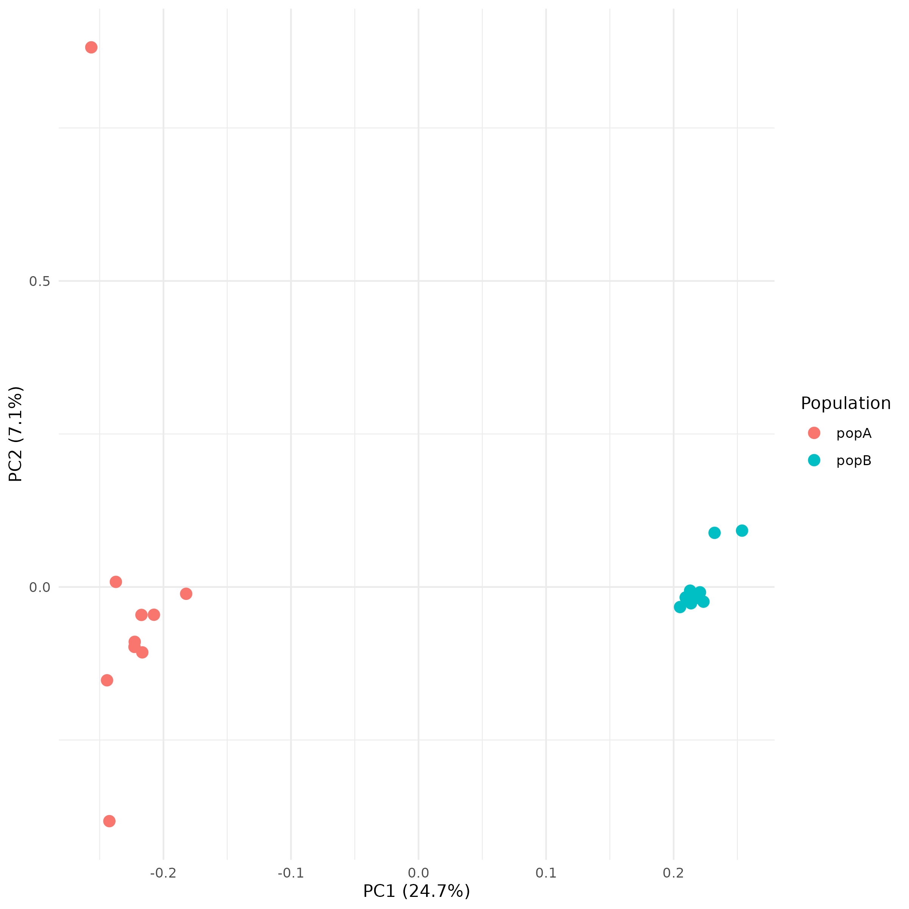

With only these two populations included, you can see that there is indeed some separation also between popA and popB. We can also see that a few samples from each population are acting a little bit like outliers. Remember that this dataset contains (simulated) data from both modern and historical samples, which also differ substantially in mapping depth. Let's edit the R-script used for plotting to also accept a third column in the popfile that indicates whether a sample is modern or historical:

`cp plot_pca.R plot_pca_with_datatype_indication.R`

Change these lines inside the Rsript:

    if (exists("pop")) {
    colnames(pop) <- c("IID", "POP")
    if (!setequal(pca_data$IID, pop$IID)) {
        stop("Sample IDs in the PLINK eigenvector file and population file do not match.")
    }
    pca_data <- merge(pca_data, pop, by = c("IID")) %>%
        # arrange by population and make factor
        arrange(POP) %>%
        mutate(POP = factor(POP, levels = unique(POP)))
    }

to: 

    if (exists("pop")) {
    colnames(pop) <- c("IID", "POP", "DATATYPE")
    if (!setequal(pca_data$IID, pop$IID)) {
        stop("Sample IDs in the PLINK eigenvector file and population file do not match.")
    }
    pca_data <- merge(pca_data, pop, by = c("IID")) %>%
        # arrange by population and make factor
        arrange(POP) %>%
        mutate(POP = factor(POP, levels = unique(POP))) %>%
        # arrange by datatype and make factor
        arrange(DATATYPE) %>%
       mutate(DATATYPE = factor(DATATYPE, levels = unique(DATATYPE)))
    }

And a bit further down, in the actual plotting command, change:

    if (exists("popfile")) {
    p <- ggplot(pca_data, aes(x = PC1, y = PC2, color = POP)) +
        geom_point(size = 3) +
        labs(x = pc1_label, y = pc2_label, color = "Population") +
        theme_minimal()
    } else {
        p <- ggplot(pca_data, aes(x = PC1, y = PC2)) +
            geom_point(size = 3) +
            labs(x = pc1_label, y = pc2_label) +
            theme_minimal()
    }

To:

    if (exists("popfile")) {
    p <- ggplot(pca_data, aes(x = PC1, y = PC2, color = POP, shape = DATATYPE)) +
        geom_point(size = 3) +
        labs(x = pc1_label, y = pc2_label, color = "Population", shape = "Data Type") +
        theme_minimal()
    } else {
        p <- ggplot(pca_data, aes(x = PC1, y = PC2)) +
            geom_point(size = 3) +
            labs(x = pc1_label, y = pc2_label) +
            theme_minimal()
    }


Then we just include that additional column (column 3) from the popfile, and replot:

```bash
cat ../data/sample_metadata.tsv | awk ' $2 == "popA" || $2 == "popB" ' | cut -f1,2,3 > pca_AB_pops/sample_popfile_AB_with_datatype.tsv

Rscript plot_pca_with_datatype_indication.R pca_AB_pops/pca_data_AB_pops_pca pca_AB_pops/sample_popfile_AB_with_datatype.tsv
```


As you can see, the "outlier" samples are all historical ones (but not all historical ones are necessarily outliers). The other two output directories in the data dir `map_and_call_out_downsample` and `map_and_call_out_downsample_rescale` attempts to account for differences in sequencing coverage (first dir), and also control for historical DNA damage patterns (second dir). 

**Bonus task**: Repeat the PCA constructions with plink using these two datasets where processing and variant calling attempts to account for differences in sequencing coverage and historical DNA damage patterns, and see if you find any differences.

### Using angsd
Although we have been using plink for PCA so far, and this has shown quite reasonable results in this case, angsd [angsd](http://www.popgen.dk/angsd/index.php/ANGSD) would arguably be a better approach for a dataset like ours, where we have a mixture of modern and historical samples with varying sequencing coverage. Angsd was specifically developed to handle differences in sequencing coverage that could otherwise have large impacts on downstream analyses. Instead of relying on hard genotype calls, angsd works directly with genotype likelihoods, which we will retrieve from the BAM files. Let's explore how to generate a PCA with angsd too, and see if we get any difference at all.

To run a PCA using angsd, we need to install both the angsd suite, as well as pcangsd, which is a tool specifically designed for performing PCA on genotype likelihoods generated by angsd. We're also going to have to index the reference genome with samtools, so we'll go ahead and install that too.


```bash
# install angsd
conda install -c bioconda angsd pcangsd samtools

# install R and the plotting packages
conda install -c conda-forge r-base r-tidyverse r-ggrepel

# then move back to the base directory and enter the ANGSD subdirectory
cd ..
cd 1.2_pca_with_angsd

```

Next, we'll convert the .cram files to .bam files. Angsd is supposed to be able to work directly on cramfiles too, but it tends not to work if the path to the reference genome used to generate the crams have changed since they were created (which obviously is the case here).

We'll just work on the standard output from map_and_call in this case, and use samtools for this conversion:

```bash
# loop through all the cram files, and convert them to bam files putting them next to the original CRAM files
for cram in ../data/map_and_call_out_standard/02_bamfiles/*.dedup.cram; do
    bam="../data/map_and_call_out_standard/02_bamfiles/$(basename "$cram" .dedup.cram).dedup.bam"
    samtools view -b -o "$bam" -T ../data/map_and_call_out_standard/00_input_data/00_reference_genome/reference_genome.fa.gz "$cram"
done

```

This will take a few minutes. When the loop has finished, make a list of the BAM files that will be used as input. The order of this list is also the order of the individuals in the ANGSD and PCAngsd output, so keep it sorted to match `../data/sample_popfile.tsv`.

```bash
# make a separate directory for the ANGSD/PCAngsd output
mkdir -p pca_angsd

# angsd has an annoying habit of renaming the samples in the output files based on the order in the BAM list, so it's important to keep the BAM list sorted consistently with the population file to make sure that the sample IDs match correctly.
# make a little loop to create a list of all the bamfiles, sorted as they are in the popfile
>pca_angsd/bamlist.txt # creates an empty bamlist file
while read sample pop; do
    bam=$(find ../data/map_and_call_out_standard/02_bamfiles -maxdepth 1 -name "$sample.dedup.bam")
    echo "$bam" >> pca_angsd/bamlist.txt
done < ../data/sample_popfile.tsv

# check that the number of CRAM files matches the number of population assignments
wc -l pca_angsd/bamlist.txt ../data/sample_popfile.tsv
```

The command below calculates genotype likelihoods using the SAMtools model (`-GL 1`) and writes them in Beagle format (`-doGlf 2`), which is the format expected by PCAngsd. The `-doMajorMinor 1` and `-doMaf 1` options also calculate the major/minor alleles and allele frequencies used during processing.

```bash

angsd \
    -b pca_angsd/bamlist.txt \
    -out pca_angsd/angsd_pca \
    -GL 1 \
    -doGlf 2 \
    -doMajorMinor 1 \
    -doMaf 1 \
    -minMapQ 30 \
    -minQ 20 \
    -SNP_pval 1e-6 \
    -nThreads 4
```


This also takes a few minutes, and if you'd be running this on a real dataset, it would be much better to run as a slurm job. For now, let's wait for it to finish, and then there should be a file called `pca_angsd/angsd_pca.beagle.gz`, containing genotype likelihoods rather than hard genotype calls. We can now use that file as input for PCAngsd:

```bash
pcangsd \
    --beagle pca_angsd/angsd_pca.beagle.gz \
    --out pca_angsd/pcangsd
```

The main PCAngsd output files are:

- `pca_angsd/pcangsd.cov`, the covariance matrix used for the PCA.
- `pca_angsd/pcangsd.log`, the log of the PCAngsd run.

The covariance matrix contains the relationships between individuals. The plotting script calculates its eigenvalues and eigenvectors directly, so separate `.eval` and `.pcangsd` files are not required. The sample order is the same as in `pca_angsd/bamlist.txt`, so `../data/sample_popfile.tsv` can be used to color the points by population.

The plotting script is similar to the one used for the Plink PCA. It reads the PCAngsd covariance matrix and calculates the PCA in R. Run it with the PCAngsd output prefix and the same BAM list used for ANGSD:

To color the points by population, provide the population file as the second argument:

```bash
Rscript plot_pca_angsd.R \
    pca_angsd/pcangsd \
    ../data/sample_popfile.tsv \
    pca_angsd/bamlist.txt
```

This creates `pca_angsd/pcangsd_pca_plot.png` and `pca_angsd/pcangsd_eigenval_bar_plot.png`.

- Any differences in comparison to the Plink PCA plot?

### Plink // PCAngsd

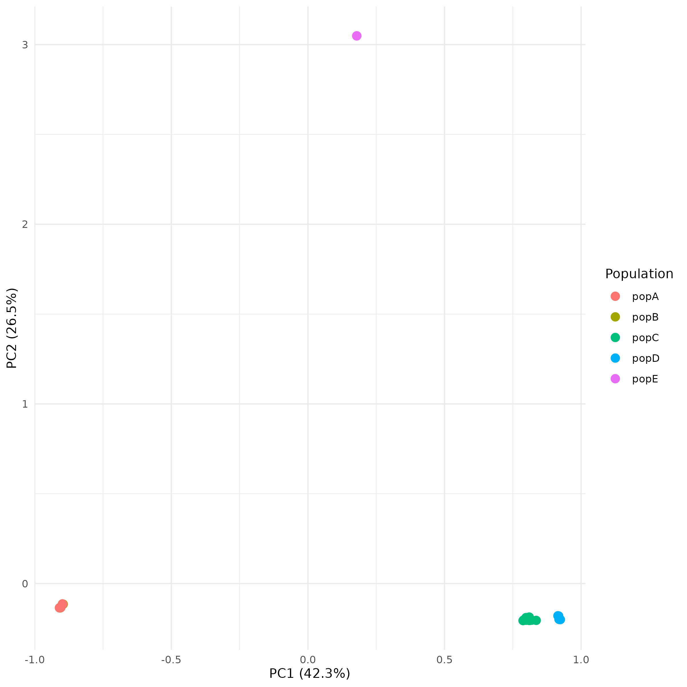


## Admixture analysis

### With ADMIXTURE

Admixture analysis is another very common method used in population genetics to infer individual ancestries and population structure. By modelling our SNP data as originating from *K* populations, we can get an idea about the number of distinct populations present in our dataset, and also whether individuals have mixed ancestry from multiple populations.

First off, we will again be working on the SNP genotype calls, as if we were working with modern, high coverage genome data. For this purpose, we will use the software called admixture:

```bash
conda install -c bioconda admixture
```

ADMIXTURE uses the binary PLINK 1 format, consisting of `.bed`, `.bim` and
`.fam` files. The PLINK PCA workflow above creates PLINK 2 files instead
(`.pgen`, `.pvar` and `.psam`), so we first prepare the filtered input and
convert it to the format expected by ADMIXTURE. Create a directory called
`2.1_admixture` and run all commands in this section from that directory:

```bash
# install PLINK 2 if it is not already available
conda install -c bioconda plink2

# enter the ADMIXTURE directory
cd 2.1_admixture

# make a directory for storing output
mkdir -p admix_stdfilt

# prepare filtered PLINK 1 files from the filtered VCF (similar filters etc. as used for the PCA)
bash prepare_admix_input.sh \
    ../data/map_and_call_out_standard/03_genotypes/01_filtered_variants/filtered_snps.vcf.gz \
    admix_stdfilt/admix_stdfilt
```

The important input files are now:

- `admix_stdfilt.bed`, the binary genotype data.
- `admix_stdfilt.bim`, the variant information.
- `admix_stdfilt.fam`, the sample order used by ADMIXTURE.

The `.fam` file is important because the rows in the ADMIXTURE output are in
this exact sample order. The `prepare_admix_input.sh` script applies the same
basic filters as the PLINK PCA workflow: biallelic SNPs with standard bases,
at most 10% missing data per individual and SNP, and a minor allele frequency
of at least 5%.

### Run ADMIXTURE for several values of *K*

The value of *K* is the number of ancestral populations assumed by the model.
Because the true value is not known in advance, it is common to run several
values and compare their cross-validation errors. Let's run *K* from 2 to 6
using 10-fold cross-validation:

```bash
for K in {2..6}; do
    bash run_admixture.sh admix_stdfilt/admix_stdfilt.bed "$K"
done
```

For each value of *K*, ADMIXTURE creates two files: 

-- `admix_stdfilt.<K>.Q`, the ancestry proportions for each individual. Each row
  is an individual and each column is one of the *K* inferred ancestral
  components.
-- `admix_stdfilt.<K>.P`, the estimated allele frequencies for the three
  ancestral populations.

In run_admixture.sh, we also capture the standard output, which contains the cv error, to a third file per K:

-- `admix_stdfilt.<K>.log`, the log file containing the cross-validation error and other messages from ADMIXTURE.


The run_admixture.sh script puts these in the directory where the input files are stored, so these files should be found in `admix_stdfilt/`.
```
ls admix_stdfilt
```
should give:

    admix_stdfilt.2.log  admix_stdfilt.3.P    admix_stdfilt.4.Q    admix_stdfilt.6.log  admix_stdfilt.afreq  admix_stdfilt.log
    admix_stdfilt.2.P    admix_stdfilt.3.Q    admix_stdfilt.5.log  admix_stdfilt.6.P    admix_stdfilt.bed
    admix_stdfilt.2.Q    admix_stdfilt.4.log  admix_stdfilt.5.P    admix_stdfilt.6.Q    admix_stdfilt.bim
    admix_stdfilt.3.log  admix_stdfilt.4.P    admix_stdfilt.5.Q    admix_stdfilt.fam


The cross-validation error indicates how well the model does in predicting our data under the assumed number of ancestral populations. The CV-error usually starts high and then steeply decreases as we reach the optimal K, which ideally reflects the true number of populations in our data set. So we want to look for the *difference* between successive CV-errors to identify the point where adding more ancestral populations no longer significantly improves the model fit, rather than looking at the absolute value.

Extract the cross-validation errors from each K from the log files with:

```bash
for K in {2..6}; do
    printf "K=%s " "$K"
    grep -h "CV error" admix_stdfilt/admix_stdfilt.${K}.log
done
```

- What K would you choose as the optimal number of ancestral populations based on the cross-validation errors?

### Plot the ancestry proportions

The standalone script `plot_admixture.R` plots a `.Q` file as stacked bars.
Individuals are ordered by population using `../data/sample_popfile.tsv`,
while their rows are first matched to the order in the `.fam` file. Install
the plotting packages if necessary:

```bash
conda install -c conda-forge r-base r-tidyverse
```

Run this from the `2.1_admixture` directory, changing `K` to the value you
want to plot:

```bash
for K in {2..6}; do
Rscript plot_admixture.R \
    admix_stdfilt/admix_stdfilt \
    "$K" \
    ../data/sample_popfile.tsv
done
```

This creates one plot per K-value:

### K=2


### K=3
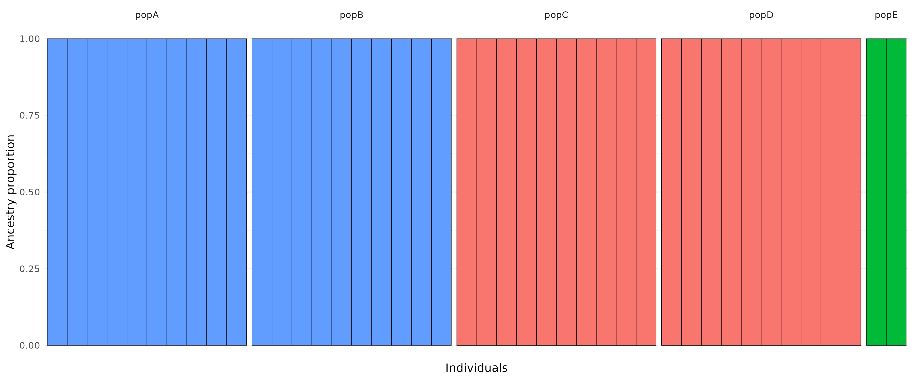

### K=4
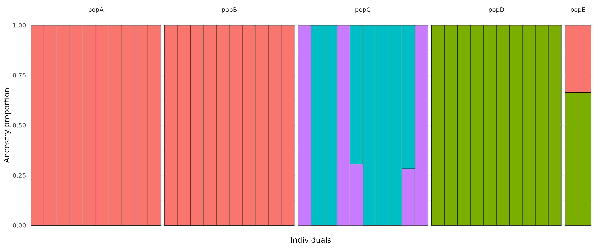

### K=5
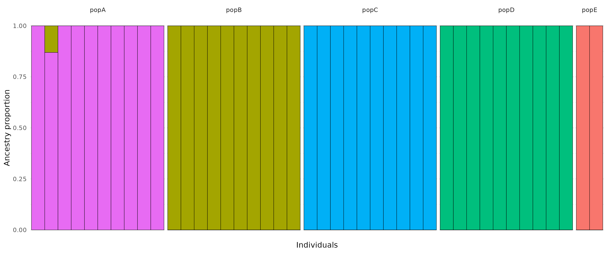

### K=6
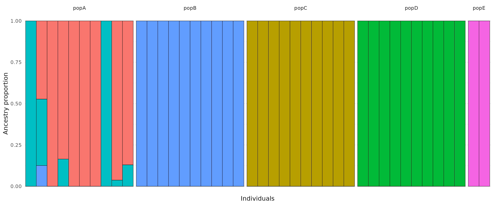


One thing that can be important to account for in population genetics analyses, which we have so far ignored, is linkage disequilibrium (LD). LD refers to the non-random association of alleles at different loci, and it can affect the inference of population structure because closely linked markers may not provide independent information and thus bias the results. To mitigate this, it is common practice to prune the genotypes before running admixture (and also PCA). If you have a large data set, you could actually remove SNPs that are statistically linked to each other using tools like PLINK with the `--indep-pairwise` option. This might be tricky in a data set like ours, where we have limited information to infer statistical linkage, and furthermore population structure in the dataset which can by itself bias LD estimates. 

A more feasible approach for a data set like ours might be to simply thin the data set, such that we only include one SNP per fixed physical distance (e.g., one SNP every 50 kb). This reduces the impact of LD while retaining a representative set of markers for population structure analyses.

PLINK 2 can do this directly with `--bp-space`. In a real dataset, you'd probably want to keep a space of >50-100 kb between genotype calls. In this very small simulated data set, however, we'll settle for 5000 bp so that we still retain some site sfor analyses. To thin the data set in this way, we use the `--bp-space` flag: 

```bash
    --bp-space 5000 \
```

The relevant part of the command would then look like this:

```bash
plink2 \
    --vcf $vcf \
    --allow-extra-chr \
    --set-all-var-ids '@:#:$r:$a' \
    --snps-only just-acgt \
    --max-alleles 2 \
    --mind $missing_ind \
    --geno $missing_snp \
    --maf $minor_allele_freq \
    --bp-space 5000 \
    --make-bed \
    --rm-dup exclude-all \
    --freq \
    --out $outname
```

Let's try and see if it makes any difference.

```bash
cp prepare_admix_input.sh prepare_admix_input_bp-space_5k.sh
# and insert the --bp-space 5000 argument into the new script

# prepare filtered PLINK 1 files from the filtered VCF, with the --bp-space argument
mkdir -p admix_bp-space_5k
bash prepare_admix_input_bp-space_5k.sh \
    ../data/map_and_call_out_standard/03_genotypes/01_filtered_variants/filtered_snps.vcf.gz \
    admix_bp-space_5k/admix_bp-space_5k

for K in 2 3 4 5 6; do
    bash run_admixture.sh \
        admix_bp-space_5k/admix_bp-space_5k.bed \
        "$K"
done

```

You'll notice that this was a lot quicker, simply because we reduced the number of SNPs by thinning the dataset.

Let's look at the CV error and admixture plots and see if anything changed:

```bash
for K in {2..6}; do
    printf "K=%s " "$K"
    grep -h "CV error" admix_bp-space_5k/admix_bp-space_5k.${K}.log
done

for K in {2..6}; do
    Rscript plot_admixture.R \
    admix_bp-space_5k/admix_bp-space_5k \
    "$K" \
    ../data/sample_popfile.tsv
done
```

### K=2
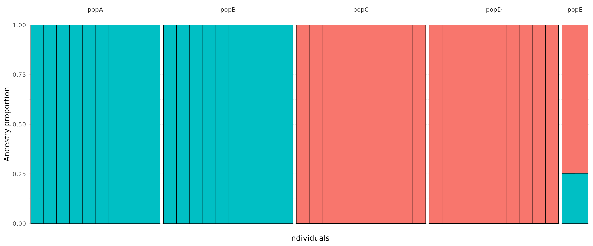

### K=3


### K=4


### K=5


- Any important differences with the thinning?

- Do the admixture results generally correspond to the PCA?

### With NGSadmix

As mentioned earlier, ADMIXTURE requires hard genotype calls, which can be unreliable for low
coverage or degraded samples. NGSadmix instead works directly with genotype
likelihoods calculated from the sequencing reads. We will therefore use the
BAM files and ANGSD to create a Beagle-format likelihood file, then use that
file as input for NGSadmix.

Create a directory called `2.2_ngsadmix` and run all commands in this section
from that directory. NGSAdmix is included in the angsd suite, so we don't need to install anything else.

```bash
mkdir -p ../2.2_ngsadmix
cd ../2.2_ngsadmix

```

As in the ANGSD PCA section, use a BAM list with the same sample order as the
population file. The order is preserved in the likelihood and NGSadmix
outputs, so it is important that these files are created together:

```bash
> bamlist.txt
while read sample pop; do
    bam=$(find ../data/map_and_call_out_standard/02_bamfiles -maxdepth 1 -name "$sample.dedup.bam")
    echo "$bam" >> bamlist.txt
done < ../data/sample_popfile.tsv

wc -l bamlist.txt ../data/sample_popfile.tsv
```

Calculate genotype likelihoods with ANGSD. The SAMtools genotype-likelihood
model (`-GL 1`) is written in Beagle format (`-doGlf 2`), which is accepted by
NGSadmix. The mapping- and base-quality filters are the same as in the ANGSD
PCA example:

```bash
angsd \
    -b bamlist.txt \
    -out angsd_ngsadmix \
    -GL 1 \
    -doGlf 2 \
    -doMajorMinor 1 \
    -doMaf 1 \
    -minMapQ 30 \
    -minQ 20 \
    -SNP_pval 1e-6 \
    -nThreads 4
```

This creates `angsd_ngsadmix.beagle.gz`. Just like for admixture, it's a good idea to prune the genotype likelihoods to get rid of strong linkage. To my knowledge, there's no widely adopted tool for thinning Beagle-format likelihood files, so I've included a very simple python script in the `bin` directory of this repo called `thin_beagle.py`. To only retain sites that are at least 5 kb apart, run:

```bash
# run the thinning script and pipe to gzip
python ../bin/thin_beagle.py angsd_ngsadmix.beagle.gz 5000 | gzip > angsd_ngsadmix.thinned5kb.beagle.gz

# check the difference in the number of sites
zcat angsd_ngsadmix.beagle.gz | wc -l
# 151111
zcat angsd_ngsadmix.thinned5kb.beagle.gz | wc -l
# 1981

```

Run NGSadmix for several values of
*K*, the number of ancestral populations. 

```bash
for K in {2..6}; do
    NGSadmix \
        -likes angsd_ngsadmix.thinned5kb.beagle.gz \
        -K "$K" \
        -minMaf 0.05 \
        -seed 42 \
        -P 4 \
        -o ngsadmix_K${K}
done
```

The main output files for each value of *K* are:

- `ngsadmix_K3.qopt`, the ancestry proportions for each individual.
- `ngsadmix_K3.fopt.gz`, the estimated allele frequencies.
- `ngsadmix_K3.log`, the run log, including the final likelihood.

The rows in `.qopt` follow the order in `bamlist.txt`. Plot the ancestry
proportions with the standalone script in this directory:

```bash
for K in {2..6}; do
    Rscript plot_ngsadmix.R \
        ngsadmix_K${K} \
        "$K" \
        bamlist.txt \
        ../data/sample_popfile.tsv
done
```

For example, the K=3 plot is written to
`ngsadmix_K3.qopt.png`. 


The plots should look something like this:

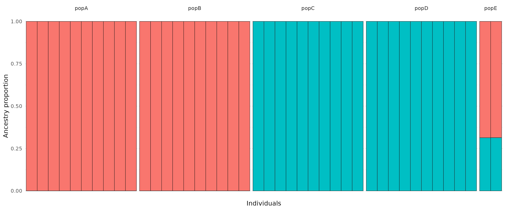
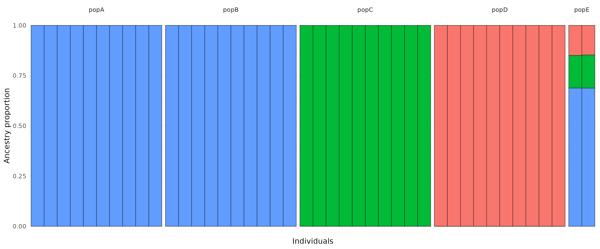
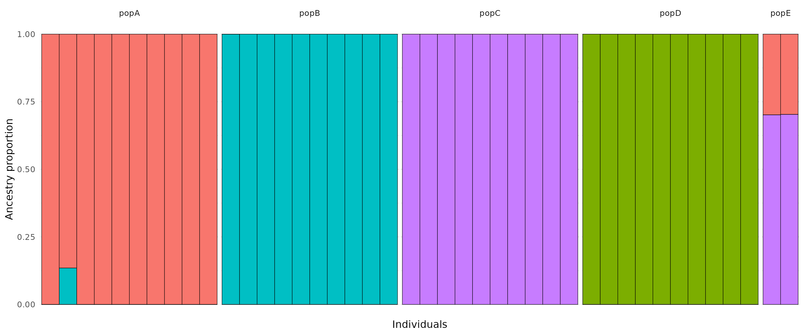
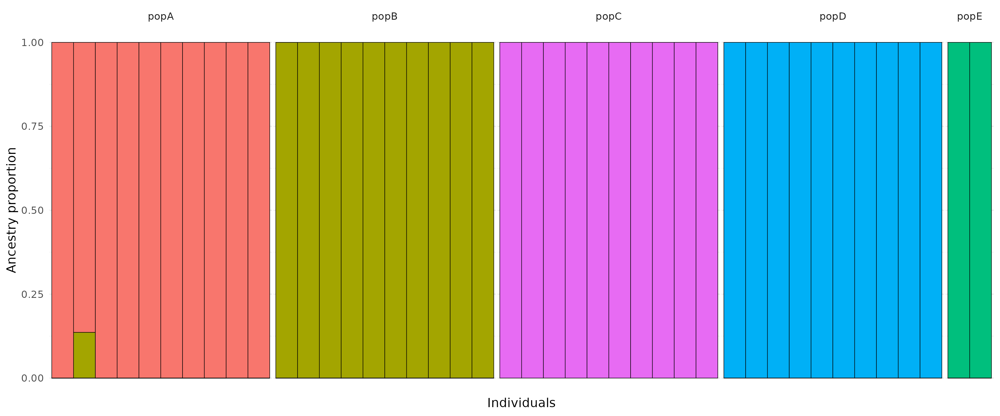
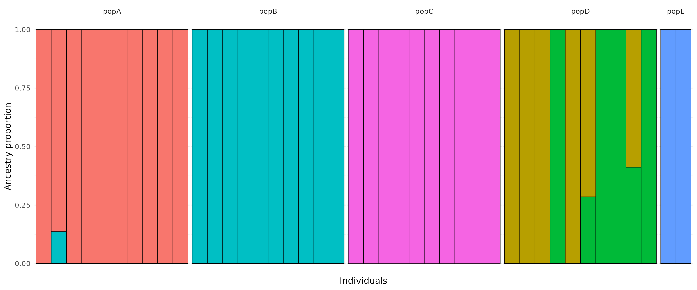

- What conclusions would you draw from these admixture plots?
- Are there any differences between angsd-based NGSadmix results and the PLINK/admixture results?

## Genome-wide phylogeny

PCA and admixture help us explore population structure. Next, let's estimate a tree describing the relationships among our populations. Different parts of a genome can have different evolutionary histories, so rather than assuming that the entire genome follows one tree, we'll first build a tree for each of many small genomic windows. We'll then use ASTRAL-IV to summarize these window trees under the multispecies coalescent model.

We'll use windows of 10 kb, starting every 500 kb along each chromosome: bases 1-10,000, 500,001-510,000, and so on, 1,000,001-1,010,000, 1,500,001-1,510,000, etc. We make short windows to capture the local genealogy for this specific locus, ideally, each locus should have little to no recombination within it and represent a single history. Dispersing them by 500kb reduces the risk of interdependence among windows – an assumption of generating species trees this way is that each tree is independent.

### Set up the analysis

From the repository root, let's move in to the `3_phylogeny` directory. If you're still in `2.2_ngsadmix`, first run `cd ..`.

```bash

cd 3_phylogeny

# Install the software we need for this part of the tutorial
conda install -c conda-forge -c bioconda bedtools iqtree=2 newick_utils aster

# Install fastaparser from GitHub, a small custom Python package for handling and filtering FASTA files
python -m pip install 'git+https://github.com/axeljen/fastaparser.git'

```

Here, [fastaparser](https://github.com/axeljen/fastaparser) handles alignment filtering, IQ-TREE 2 estimates the window trees, newick-utils edits those trees, and the ASTER package provides `astral4`. Check `iqtree2 --version` and `astral4 -h` before continuing. 

We'll use the BAM files created in the ANGSD PCA section, rather than reading the CRAM files directly. If you haven't converted them yet, use the conversion commands in that section first. Keep using the **same reference** that was used for mapping. 


### Generate bed file with windows

First, we'll use bedtools to create a table of the genomic regions in which we'll ultimately generate the locus trees, by feeding the reference fasta index and a window and step size:

```bash

reference_index=../data/map_and_call_out_standard/00_input_data/00_reference_genome/reference_genome.fa.gz.fai
bedtools makewindows -g "$reference_index" -w 10000 -s 500000 > windows.bed

```
Inspect the windows.bed file:

```bash
head windows.bed
```

    chr1    0       10000
    chr1    500000  510000
    chr2    0       10000
    chr2    500000  510000
    chr3    0       10000
    chr3    500000  510000
    chr4    0       10000
    chr4    500000  510000
    chr5    0       10000
    chr5    500000  510000

Each row represents one region in the reference genome in which we will:
1) extract a consensus sequence and combine into a multi-fasta alignment including all samples in the data set
2) perform a phylogenetic analysis on the extracted sequences with iqtree to build a phylogenetic tree
3) use newick utils to collapse nodes in the resulting window tree that are poorly supported by the data

Finally, we will concatenated the trees from all windows into a single file, and summarize these into a genome-wide species tree using astral.

### Make masked sequences with ANGSD

To go from the mapped BAM format to sequences resembling a consensus sequence for each sample, we'll use ANGSD's `-doFasta 1` option to randomly sample one observed base at each position, separately for every individual. This produces a pseudo-haploid sequence, by randomly choosing one allele at each site. This is a fairly robust way to generate consensus sequences from a set of samples that may vary in sequencing coverage.

We'll generate and mask a genome-wide sequence once per sample, then extract all the windows from those indexed FASTAs. 

We will use the mappability mask files to ensure that we only keep positions in the bam file that we are confident about. The masks need particular care. These are **positive masks**: the BED intervals describe positions we trust and want to keep.

`bedtools maskfasta` masks the intervals it receives, so passing the positive mask directly would do the opposite of what we want! Instead, we'll first calculate its **complement**, meaning all positions outside the trusted intervals, and replace those bases with `N`.

The dofasta_and_mask.sh script will run a few different steps for each sample. This script takes a bam file and a mask file as input arguments, and will produce a masked, whole-genome fasta consensus sequence.

To run for a single sample, one would run:
`bash dofasta_and_mask.sh <sample.bam> <sample.mask.bed>`

But we'll write a little loop to iterate over all bam files:
```bash
for bam in ../data/map_and_call_out_standard/02_bamfiles/*.dedup.bam; 
do
    # get the sample name from the BAM file so we can find the corresponding mask (it's the snp_mask.bed.gz file we should use here, contains all mappable regions with indels excluded)
    sample=$(basename "$bam" .dedup.bam)
    mask=../data/map_and_call_out_standard/03_genotypes/02_maskfiles/"$sample"_snp_mask.bed.gz
    bash dofasta_and_mask.sh "$bam" "$mask"
done

```

This creates one masked consensus sequence per sample, `consensus/<sample>.masked.fa`, together with its index (`.fai`).

When doing this on real data, if you're on a cluster, this could (should) be parallelized by submitting each sample as a separate slurm job, rather than running all samples sequentially on a single node. The template `slurmscripts/3_dofasta_and_mask_array.sh` does exactly this as an array job, with one task per sample. See [slurmscripts/README.md](slurmscripts/README.md) for how to submit it.

Once we have consensus sequences for all samples, we can use samtools to extract the sequences for each window in `windows.bed`. Since these FASTAs come from alignments to the same reference genome, the sequences share coordinates and need no additional alignment.

```bash
mkdir -p windows_raw windows_filtered logs

# Process each window in windows.bed
while IFS=$'\t' read -r chrom start end; do
    region="${chrom}:$((start + 1))-${end}"
    > "windows_raw/${chrom}_${start}_${end}.fa"
    for consensus in consensus/*.masked.fa; do
        sample=$(basename "$consensus" .masked.fa)
        samtools faidx "$consensus" "$region" | sed "s/^>.*$/>$sample/" \
         >> "windows_raw/${chrom}_${start}_${end}.fa"
    done
done < windows.bed
```

Each alignment in `windows_raw` now contains one 10 kb sequence per individual. Because all reads were mapped to the same reference, the extracted sequences already share genomic coordinates; we don't need a separate multiple-sequence alignment program here. This assumes the reference mapping is appropriate and does not resolve structural differences or mapping bias.

```bash
for alignment in windows_raw/*.fa; do
    window=$(basename "$alignment" .fa)
    if fastaparser filter \
        -i "$alignment" \
        --max-missing-seq 0.30 \
        --max-missing-site 0.20 \
        -o "windows_filtered/${window}.fa" 2> "logs/${window}.filter.log"; then
        :
    elif grep -Eq 'No sequences remain after filtering|No sites remain after filtering' "logs/${window}.filter.log"; then
        rm -f "windows_filtered/${window}.fa"
        echo "Discarded empty alignment: $window"
    else
        # an unexpected error: print the log and stop the loop
        cat "logs/${window}.filter.log" >&2
        break
    fi
done
```

Fastaparser first removes sequences with **more than 30% missing data**. It then removes columns with **more than 20% missing data among the remaining sequences**. It treats `N`, `X`, `?`, and gaps as missing. A sample can be retained in one window but excluded in another. ASTRAL can use trees with missing samples, but check the IQ-TREE reports for windows with too few informative sites to estimate a reliable tree.


### Estimate a tree for each window

Let's run IQ-TREE 2 separately on each alignment that passed filtering:

```bash
mkdir -p trees
for alignment in windows_filtered/*.fa; do
    window=$(basename "$alignment" .fa)
    iqtree2 \
        -s "$alignment" \
        -m MFP \
        -B 1000 \
        -T 1 \
        --prefix "trees/$window" || { echo "IQ-TREE failed for $window" >&2; break; }
done
```

`-s` gives the alignment. `-m MFP` runs ModelFinder to choose a nucleotide substitution model for that window. `-B 1000` calculates support using 1,000 **ultrafast bootstrap** replicates, and `-T 1` uses one thread. These are not 1,000 conventional bootstrap replicates. The `.iqtree` report includes the selected model and diagnostics; inspect it for warnings, including windows with too little variation. The `.treefile` contains the maximum-likelihood tree with bootstrap support labels. These are the trees we'll filter and use for ASTRAL downstream.

Running IQTree sequentially for each winodw one after another like this will take some time. If you want to speed it up, and especially if running on a large data-set, I strongly recommend that you submit one slurm job per window instead of running it sequentially like this. The template `slurmscripts/3_iqtree_array.sh` does this as an array job, with one task per window (see [slurmscripts/README.md](slurmscripts/README.md)).

Next, collapse internal branches with support **below 20%** using newick-utils. This is somewhat of an arbitrary cutoff, but it's good to do some filtering to remove very weakly supported splits before combining the trees with ASTRAL. 

```bash
for tree in trees/*.treefile; do
    nw_ed "$tree" 'i & b < 20' o > "${tree%.treefile}.collapsed.nwk"
done

cat trees/*.collapsed.nwk > window_trees.nwk
# check how many window trees we have
wc -l window_trees.nwk
```

In `nw_ed`, `i` selects internal nodes, `b` is the numerical bootstrap label, and `o` collapses the selected branch. A branch labelled 20 is retained; one labelled 19 is collapsed. Collapsing produces a **polytomy**, an unresolved split with more than two descendants, rather than asking ASTRAL to treat an extremely uncertain split as established. ASTRAL accepts these unresolved trees and trees with missing samples.

### Combine the window trees with ASTRAL-IV

Different window trees can disagree because of estimation error, but also because gene copies can trace their ancestry differently from the populations containing them. This is called **incomplete lineage sorting**. ASTRAL looks for a population or species tree that best agrees with the quartet relationships across the input trees under a coalescent model. Here, a quartet is simply a set of four tips and their relationships.

A simple astral4 command looks like this:

```bash
astral4 \
    -o astral_tree.nwk \
    window_trees.nwk

cat astral_tree.nwk
```

The result, `astral_tree.nwk`, is a Newick-format tree whose tips are the individual samples. ASTRAL-IV reports branch lengths in **substitutions per site** using integrated CASTLES-II, and its default branch supports are **local posterior probabilities**.

Open the tree in a viewer such as [FigTree](https://github.com/rambaut/figtree) or [treeviewer](https://treeviewer.org/) to explore its topology and support.

**Hint** Root the tree using the outgroup (popE samples) to be able to interpret the relationships among the other populations correctly.

- Does the population tree agree with the broad structure in the PCA and admixture analyses?
- Are any relationships poorly supported, and do the window trees tend to disagree about those relationships?
- Could the admixture we explored earlier help explain disagreement between genomic regions?

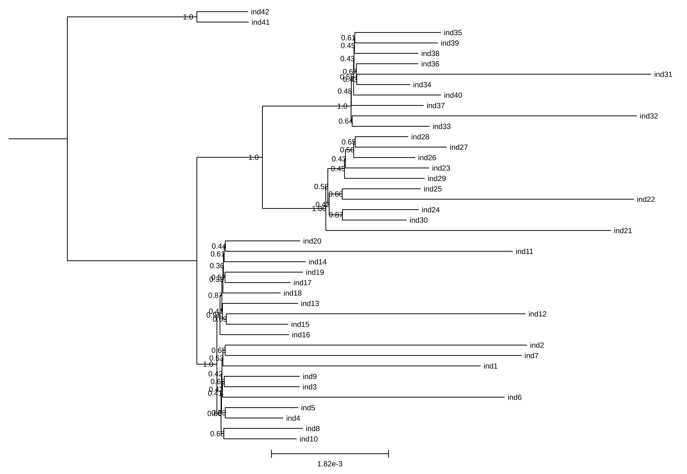

- Can you think of any reason for some individuals having much longer terminal branches than the others? (hint: think about the potential impact of data type/sequencing coverage)
- Bonus task: see if generating the trees from downsampled and/or rescaled bam files makes any difference.