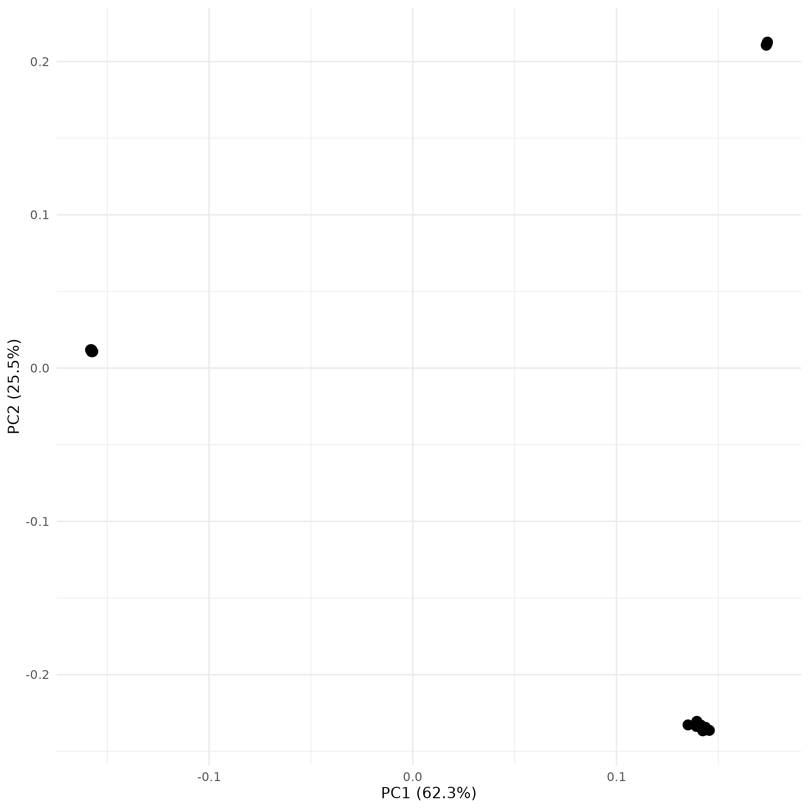
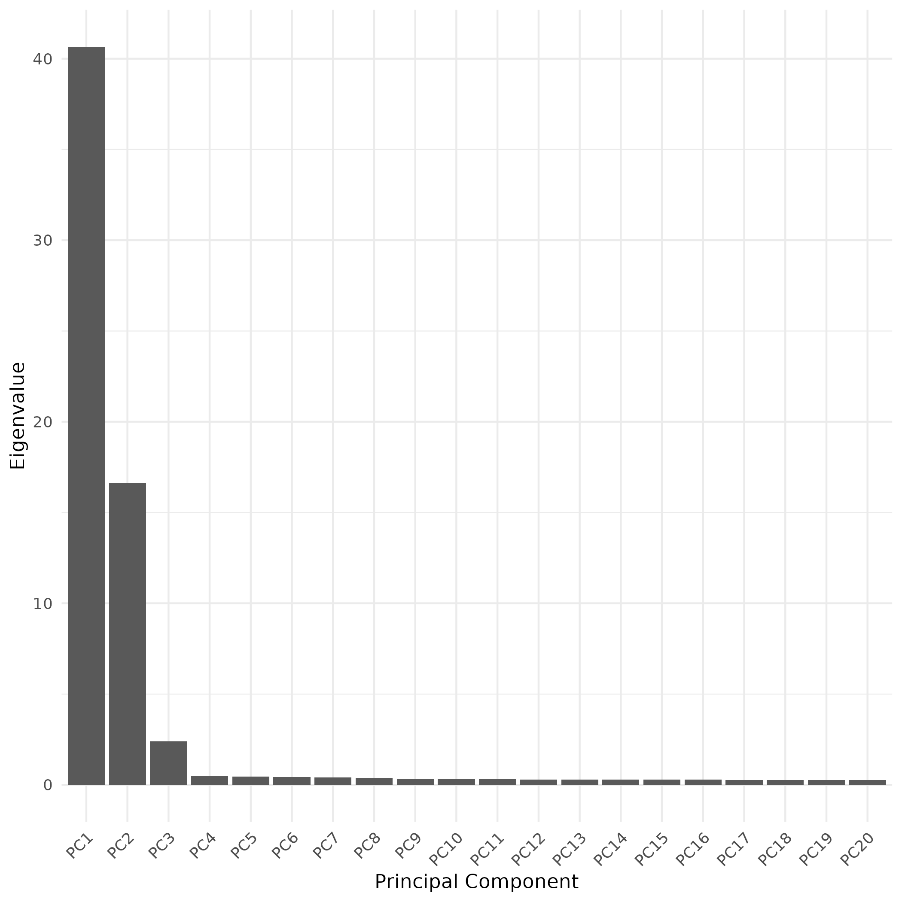
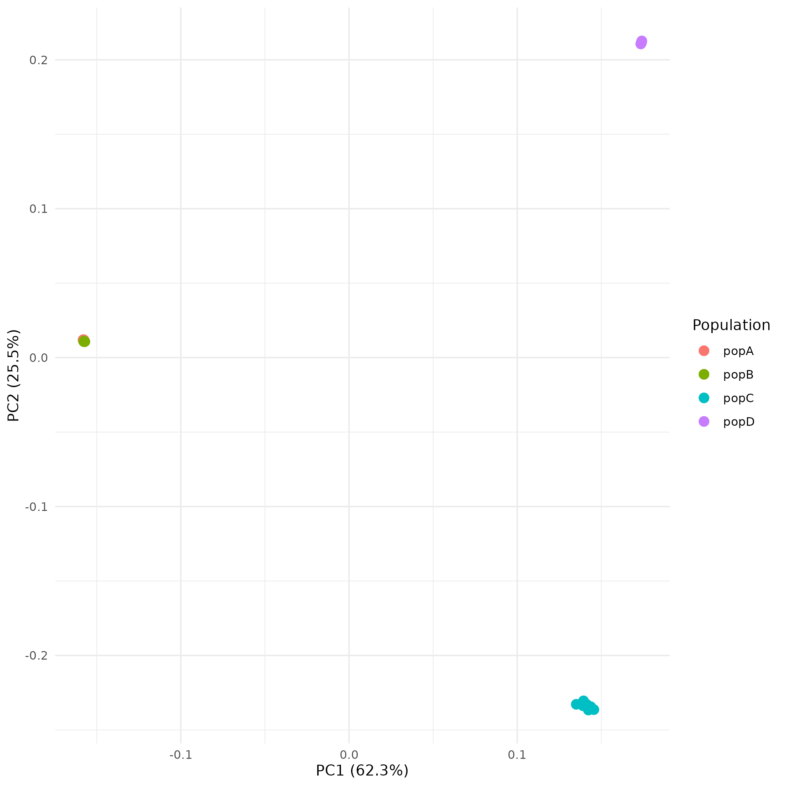
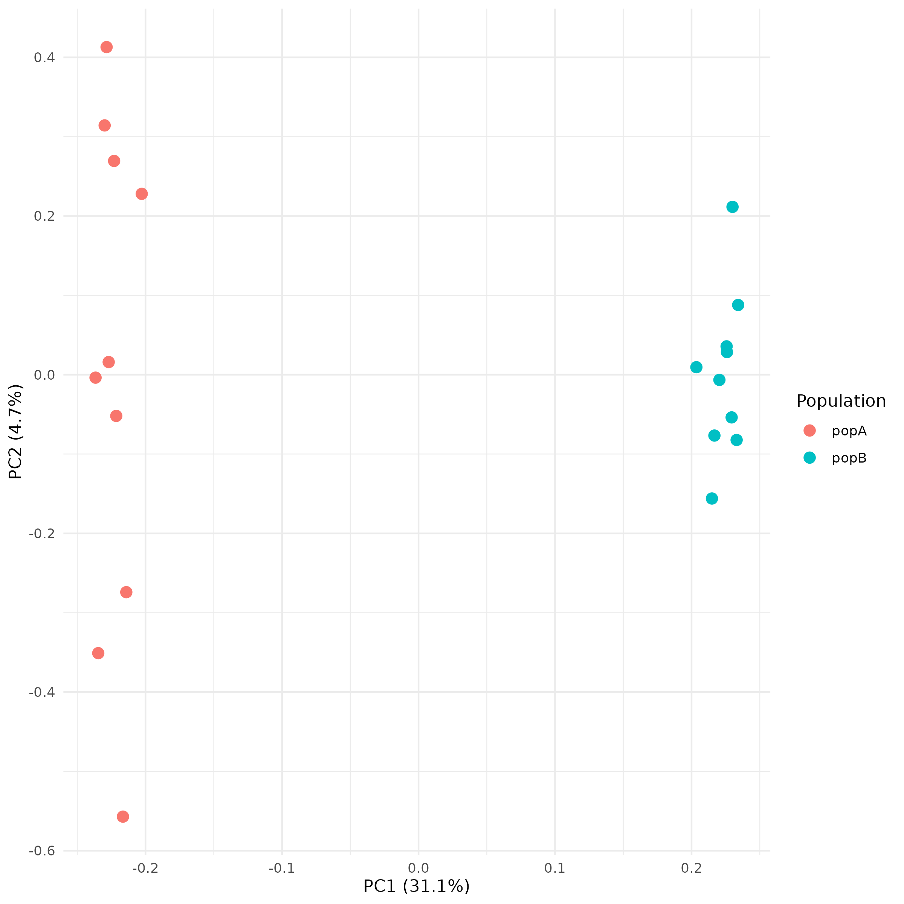
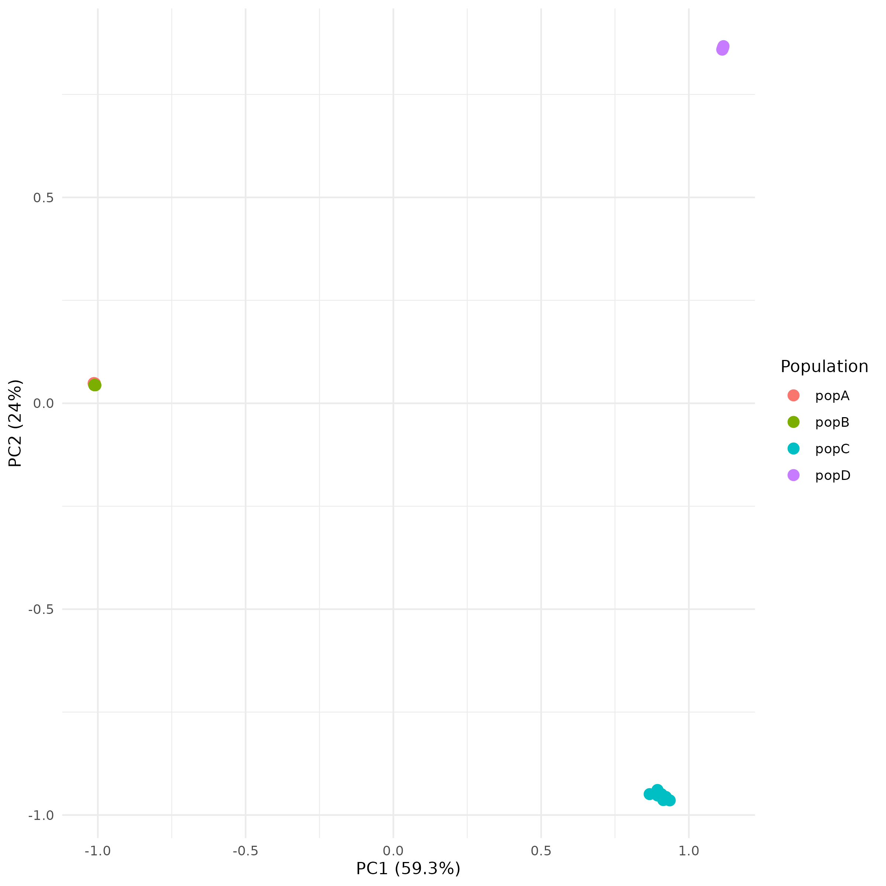

# Popgen tutorial

This tutorial will guide you through some of the most common population genetics analyses.

The data we will use in this tutorial was simulated based on five fictional populations, which has been processed to generate alignments and genotypes, using the map_and_call pipeline. To follow along from the very beginning, see the [map and call pipeline tutorial](https://github.com/axeljen/mapcall_tutorial).

If you've run this previous tutorial, you are of course very welcome to directly use the output from that tutorial. Otherwise, we'll download the output data here, so also fine to just start from here.


## Get started

First, make a directory in which you want to run this tutorial and navigate into it:


    mkdir popgen_tutorial
    cd popgen_tutorial

Then you can clone this repo if you want to to have this readme file directly available to follow along:

```bash
    git clone https://github.com/axeljen/popgen_tutorial.git

    # download the archived data folder
    curl -L https://osf.io/download/n4hwb/ -o data.tar
    # and unpack it
    tar -xvf data.tar

    # remove the archive
    rm data.tar
```

Let's have a look at what's inside the data folder:

```bash
    ml tree # on dardel, we need to load tree as a module. if elsewhere, it might be available directly, but otherwise you can just skip this part.
    tree -d data -L 2
```
Should look something like this:

    data
    ├── 00_input_data
    │   └── 00_reference_genome
    ├── 01_reports
    │   ├── 00_fastqc
    │   ├── 01_qualimap
    │   └── 02_variantstats
    ├── 02_bamfiles
    │   ├── dedup_metrics
    │   └── mapping_depths
    └── 03_genotypes
        ├── 00_raw_variants
        ├── 01_filtered_variants
        └── 02_maskfiles

    14 directories

Where:
- `00_input_data/00_reference_genome` contains the reference genome for the analysis.
- `01_reports` contains quality control and variant statistics reports.
- `02_bamfiles` contains the aligned BAM files along with deduplication metrics and mapping depths.
- `03_genotypes` contains the raw and filtered variant calls as well as mask files, defining regions in the genome where reliable genotype calls can be made.

If you don't have tree installed, you can install it, for example, with conda/mamba. 

We'll use conda in this tutorial to handle all installations. If [conda](https://docs.conda.io/en/latest/miniconda.html) is not installed, please install it first. If you're on dardel, you can just load conda as a module `ml PDC miniconda3`. Once you're ready to go, let's create an environment that we can add packages to:

```bash
    # let's create an environment
    conda create -n popgen_tutorial_env
    # it'll ask you for where to install the environment. By default, this will be in your home directory under .conda/envs. For now this is fine, but know that conda tends to generate lots and lots and lots of files, so when you're creating big things later on, you'll probably want to change this to a location where you have a solid allocation.

    # this will create a virtual environment, where we can install programs as we go.
    
    # to activate that virtual environment, go:
    conda activate popgen_tutorial_env
    # if you're using the dardel module, you'll have to run source instead:
    source activate popgen_tutorial_env
    
```

## Principal components analysis (PCA)

Now that we've got everything set up, let's start with running a PCA on our genotype data. 

### Using Plink

In this tutorial, we're only using simulated data resembling modern, high coverage sequencing data. When this is the case, we can be pretty confident in our genotype calls in the vcf file, so we can use the genotypes, or specifically the single nucleotide polymorphisms (SNP), in the vcf as input for running the pca. A popular program for running PCA on SNP data is plink. Let's move into the folder 1.1_pca_with_plink, and work inside that folder for this part.

```bash
    # go into subdir
    cd 1.1_pca_with_plink

    # for this part, we'll need plink (specifically plink2) to be installed, let's add that to our virtual environment
    conda install bioconda::plink2
    # this installs plink2 in the popgen_tutoral_env (it'll ask you to proceed so you'll need to confirm by typing 'y' when prompted.) Once installed, plink2 will be available to use as long as we have the popgen_tutorial_env activated

```

Plink requires a bit of preparation before we can run the actual PCA. Have a look at the `prepare_plink_input.sh` script. First, you'll see the vcf=$1 and outname=$2 lines, this is called command line arguments, and allows us to dynamically provide the input VCF file and the output prefix when running the script, meaning it would be executed as `bash prepare_plink_input.sh <input.vcf> <output_prefix>`:

This will take `input.vcf` as the input file and generate Plink files with the prefix `output_prefix`. 

After these lines, you'll see a bunch of variable assignments that define the filtering parameters that plink will apply to our data when prepping the input. These include thresholds for missing data per individual and per SNP, the minimum minor allele frequency, and the linkage disequilibrium pruning threshold. Adjusting these parameters allows you to control the quality and characteristics of the dataset that will be used for the PCA. They are currently set at quite reasonable and commonly used values, so you probably don't need to worry about this right now, but you can always play around with them and see how they affect your results.

So let's find the relative path to the vcf file to use, and run the script:

```bash
    # So the vcf file that we'll use is located in the ../data/03_genotypes/01_filtered_variants directory
    # let's check the content of this dir
    find ../data/03_genotypes/01_filtered_variants

        # ../data/03_genotypes/01_filtered_variants
        # ../data/03_genotypes/01_filtered_variants/filtered_indels.vcf.gz
        # ../data/03_genotypes/01_filtered_variants/filtered_indels.vcf.gz.csi
        # ../data/03_genotypes/01_filtered_variants/filtered_snps.vcf.gz.csi
        # ../data/03_genotypes/01_filtered_variants/filtered_snps.vcf.gz
    # the last one, ../data/03_genotypes/01_filtered_variants/filtered_snps.vcf.gz is the one we want to use. Let's run the prepper script:

    # let's make a separate directory for this particular output, to keep it tidy
    mkdir -p pca_std_filt
    bash prepare_plink_input.sh ../data/03_genotypes/01_filtered_variants/filtered_snps.vcf.gz pca_std_filt/pca_data_std_filt

```

Plink has a lot of different filtering and parsing parameters available, and there's quite a few of them that we need to use and a whole bunch that we probable best use too. In the script above, the command that generates the output files looks like this:

    plink2 \
        --vcf $vcf \
        --allow-extra-chr \
        --set-all-var-ids '@:#:$r:$a' \
        --snps-only just-acgt \
        --max-alleles 2 \
        --mind $missing_ind \
        --geno $missing_snp \
        --maf $minor_allele_freq \
        --make-pgen \
        --rm-dup exclude-all \
        --out $outname

To break this down a bit:
plink2 is the actual command, and then follows one parameter per line. Using the backslash at the end of each line allows the command to continue onto the next line, making it more readable. If we would have omitted the backslash at the end of each line and still written the command across multiple line, it would've failed.

`--vcf $vcf`
 specifies the input VCF file that Plink will use. The `$vcf` variable is set to the first command line argument when running the `prepare_plink_input.sh` script.

`--allow-extra-chr`
allows Plink to handle chromosomes that are not part of the standard set (1-22, X, Y, MT). This is useful if your VCF contains additional contigs or scaffolds.

`--set-all-var-ids '@:#:$r:$a'`
sets a unique identifier for each variant based on its chromosome, position, reference allele, and alternate allele.

`--snps-only just-acgt`
ensures that only SNPs with standard nucleotide alleles (A, C, G, T) are considered.

`--max-alleles 2`
restricts the analysis to biallelic variants only.

`--mind $missing_ind`
filters out individuals with a missing genotype rate higher than the specified threshold. the variable $missing_ind is defined at the beginning of the script and can be adjusted as needed. 10 % missing data per individual (as used here) is probably quite strict, could be relaxed depending on the dataset.

`--geno $missing_snp`
filters out SNPs with a missing genotype rate higher than the specified threshold. The variable $missing_snp is defined at the beginning of the script and can be adjusted as needed. 10 % missing data per SNP (as used here) is probably a good starting point for many popgen purposes.

`--maf $minor_allele_freq`
filters out SNPs with a minor allele frequency below the specified threshold. The variable $minor_allele_freq is defined at the beginning of the script and can be adjusted as needed. A common choice is 0.05, also used here, meaning that SNPs with a minor allele frequency below 5% will be excluded.

`--make-pgen`
tells Plink to generate the binary PED files (.pgen, .pvar, .psam) as output.
<!-- 
`--indep-pairwise 50 5 $linkage_pruning_threshold`
performs linkage disequilibrium pruning to remove highly correlated SNPs. The parameters `50 5 $linkage_pruning_threshold` specify the window size, step size, and r^2 threshold for pruning, respectively. The variable `$linkage_pruning_threshold` is defined at the beginning of the script and can be adjusted as needed.

`--bad-ld`
This flag is necessary if using the `--indep-pairwise` command on datasets wuth fewer than 50 individuals, just telling plink to ignore the fact that we're probably getting quite bad ld estimates here to base the pruning on. An alternative is to thin the dataset with physical distance instead, for example with vcftools, prior to running plink. -->

`--rm-dup exclude-all`
removes duplicate variants from the analysis. Duplicate variants can remain in the dataset after decomposing multiallelic sites, and plink will throw an error if this is the case unless this flag is used.

`--freq`
tells Plink to calculate allele frequencies for the SNPs in the dataset. The output will be written to a file with the `.afreq` extension, which can be used in subsequent analyses, such as PCA. This is required if the number of samples in the data is less than 50, otherwise plink will estimate allele frequencies on the fly.

`--out $outname`
specifies the prefix for the output files.

So, all the output files from this command will be prefixed with the value specified by the `--out` option, which in this case is `$outname`. So to move on to the actual pca, we can just use this prefix when referring to the Plink files in the subsequent steps.


```bash

    bash plink_pca.sh pca_std_filt/pca_data_std_filt

```

This will create three additional files:

    pca_std_filt/pca_data_std_filt_pca.eigenval
    pca_std_filt/pca_data_std_filt_pca.eigenvec
    pca_std_filt/pca_data_std_filt_pca.log

- The `.eigenval` file contains the eigenvalues, which indicate the amount of variance explained by each principal component.
- The `.eigenvec` file contains the eigenvectors, which represent the principal components for each individual.
- The `.log` file contains the log of the PCA computation, including any warnings or errors encountered during the analysis.

Let's visualize the first two principal components using a simple scatter plot in R:

```bash

    # to be able to plot this with R, we need R and the R-package tidyverse installed. If it isn't, install to our environment with conda:
    conda install -c conda-forge r-base r-tidyverse r-ggrepel

    # then, we can use the plot_pca.R script:
    Rscript plot_pca.R pca_std_filt/pca_data_std_filt_pca

```

This will produce two plots: `pca_std_filt/pca_data_std_filt_pca_pca_plot.png` and `pca_std_filt/pca_data_std_filt_pca_eigenval_bar_plot.png`

Inspect the plots, they should look something like this:




The first plot is the actual PCA. Each point in the scatter plot represents an individual, positioned according to their scores on the first two principal components. The second plot shows the eigenvalues, which indicate the amount of variance explained by each principal component.

1) What do you observe in the PCA plot? Are there any distinct clusters of individuals? How many populations would you say that there are based on this?

2) From the eigenvalues, do you think it makes sense that we extract the first two principal components and plot those?


To make things a little bit clearer, we can color the points in the PCA plot by the population they belong to. For this, we'll need a population assignment file, just listing one sample per line, and what population they were sampled from. Together with the data in this tutorial such a file was included, named sample_metadata.tsv. This file contains three columns, sequencing_id, original_id and population. Sequencing_id was only used for the mapping and variant calling step, so we can ignore that for now. Let's subset the sample_metadata.tsv file to only include the two last columns, remove the header line, and put that in a new file:

```bash
# use cut to extract the second and third columns (original_id and population) and then tail to only start reading from the second line to remove the header line
cut -f2,3 ../data/sample_metadata.tsv | tail -n +2 > ../data/sample_popfile.tsv
```

The `plot_pca.R` script was written to optionally take a populatiion file like this as input, and color the points in the PCA plot according to the population each individual belongs to. So let's rerun with the population file:

```bash
Rscript plot_pca.R pca_std_filt/pca_data_std_filt_pca ../data/sample_popfile.tsv
```



3) Did coloring the points by population help you to better distinguish the different clusters? Any new insights compared to the uncolored PCA plot?

Clearly, population A and B end up more or less on top of each ither and any pattern there is difficult to discern. Let's make a PCA with only samples from population A and B:

```bash

# make a directory for storing files related to this subset analysis
mkdir -p pca_AB_subset

# extract a list of the samples to include
cat ../data/sample_popfile.tsv | awk ' $2 == "popA" || $2 == "popB" {print $1}' > pca_AB_subset/AB_samples_to_include.txt

# then we can simply pass this list to plink with the --keep flag, so let's copy the plink prepping script and add that argument
cp prepare_plink_input.sh prepare_plink_input_subset.sh

```

Edit the `prepare_plink_input_subset.sh` script to include the `--keep` flag with the list of samples to look something like:


    # take the vcf file as first argument
    vcf=$1

    # and a prefix name for the plink files as second argument
    outname=$2

    # list of samples to keep
    samples=$3

    ## filtering parameters
    missing_ind=0.10 # minimum individual missingness threshold, i.e., individuals with more than 10% missing genotypes will be excluded
    missing_snp=0.10 # minimum SNP missingness threshold, i.e., SNPs with more than 10% missing genotypes will be excluded
    minor_allele_freq=0.05 # minimum minor allele frequency threshold, i.e., SNPs with a minor allele frequency below 5% will be excluded
    # linkage_pruning_threshold=0.2 # threshold for linkage disequilibrium pruning, i.e., SNPs with an r^2 value above this threshold will be pruned
    plink2 \
        --vcf $vcf \
        --allow-extra-chr \
        --set-all-var-ids '@:#:$r:$a' \
        --snps-only just-acgt \
        --max-alleles 2 \
        --mind $missing_ind \
        --geno $missing_snp \
        --maf $minor_allele_freq \
        --make-pgen \
        --rm-dup exclude-all \
        --freq \
        --keep $samples \
        --out $outname

And then prepare a new set of pca input files:

```bash
bash prepare_plink_input_subset.sh ../data/03_genotypes/01_filtered_variants/filtered_snps.vcf.gz pca_AB_subset/pca_data_AB_subset pca_AB_subset/AB_samples_to_include.txt

# run the pca
bash plink_pca.sh pca_AB_subset/pca_data_AB_subset

# make a subset population map and plot
cat ../data/sample_popfile.tsv | awk ' $2 == "popA" || $2 == "popB" ' > pca_AB_subset/AB_sample_popfile.tsv
Rscript plot_pca.R pca_AB_subset/pca_data_AB_subset_pca pca_AB_subset/AB_sample_popfile.tsv

```
This is what that plot looks like:


Not super useful, perhaps, but at least it's clear that you can separate also these ones...

### Using angsd

Had we been working with low-coverage sequencing data, or historical samples where the DNA might have been fragmented etc., [angsd](http://www.popgen.dk/angsd/index.php/ANGSD) would have been a more appropriate tool for performing PCA and other population genetic analyses. Angsd was specifically developed to handle differences in sequencing coverage that could otherwise have large impacts on downstream analyses. Instead of relying on hard genotype calls, angsd works directly with genotype likelihoods, which we will retrieve from the BAM files.

To run a PCA using angsd, we need to install both the angsd suite, as well as pcangsd, which is a tool specifically designed for performing PCA on genotype likelihoods generated by angsd. We're also going to have to index the reference genome with samtools, so we'll go ahead and install that too.

```bash
# install angsd
conda install -c bioconda angsd pcangsd samtools

# install R and the plotting packages
conda install -c conda-forge r-base r-tidyverse r-ggrepel

# then move back to the base directory and enter the ANGSD subdirectory
cd ..
cd 1.2_pca_with_angsd

```

Next, we'll convert the .cram files to .bam files. Angsd is supposed to be able to work directly on cramfiles too, but it tends not to work if the path to the reference genome used to generate the crams have changed since they were created (which obviously is the case here).

We can use samtools for this conversion:

```bash
# loop through all the cram files, and convert them to bam files putting them next to the original CRAM files
for cram in ../data/02_bamfiles/*.dedup.cram; do
    bam="../data/02_bamfiles/$(basename "$cram" .dedup.cram).dedup.bam"
    samtools view -b -o "$bam" -T ../data/00_input_data/00_reference_genome/reference_genome.fa.gz "$cram"
done

```

This will take a few minutes. When the loop has finished, make a list of the BAM files that will be used as input. The order of this list is also the order of the individuals in the ANGSD and PCAngsd output, so keep it sorted to match `../data/sample_popfile.tsv`.

```bash
# make a separate directory for the ANGSD/PCAngsd output
mkdir -p pca_angsd

# angsd has an annoying habit of renaming the samples in the output files based on the order in the BAM list, so it's important to keep the BAM list sorted consistently with the population file to make sure that the sample IDs match correctly.
# make a little loop to create a list of all the bamfiles, sorted as they are in the popfile
>pca_angsd/bamlist.txt # creates an empty bamlist file
while read sample pop; do
    bam=$(find ../data/02_bamfiles -maxdepth 1 -name "$sample.dedup.bam")
    echo "$bam" >> pca_angsd/bamlist.txt
done < ../data/sample_popfile.tsv

# check that the number of CRAM files matches the number of population assignments
wc -l pca_angsd/bamlist.txt ../data/sample_popfile.tsv
```

The command below calculates genotype likelihoods using the SAMtools model (`-GL 1`) and writes them in Beagle format (`-doGlf 2`), which is the format expected by PCAngsd. The `-doMajorMinor 1` and `-doMaf 1` options also calculate the major/minor alleles and allele frequencies used during processing.

```bash

angsd \
    -b pca_angsd/bamlist.txt \
    -out pca_angsd/angsd_pca \
    -GL 1 \
    -doGlf 2 \
    -doMajorMinor 1 \
    -doMaf 1 \
    -minMapQ 30 \
    -minQ 20 \
    -SNP_pval 1e-6 \
    -nThreads 4
```


This also takes a few minutes, and if you'd be running this on a real dataset, it would be much better to run as a slurm job. For now, let's wait for it to finish, and then there should be a file called `pca_angsd/angsd_pca.beagle.gz`, containing genotype likelihoods rather than hard genotype calls. We can now use that file as input for PCAngsd:

```bash
pcangsd \
    --beagle pca_angsd/angsd_pca.beagle.gz \
    --out pca_angsd/pcangsd
```

The main PCAngsd output files are:

- `pca_angsd/pcangsd.cov`, the covariance matrix used for the PCA.
- `pca_angsd/pcangsd.log`, the log of the PCAngsd run.

The covariance matrix contains the relationships between individuals. The plotting script calculates its eigenvalues and eigenvectors directly, so separate `.eval` and `.pcangsd` files are not required. The sample order is the same as in `pca_angsd/bamlist.txt`, so `../data/sample_popfile.tsv` can be used to color the points by population.

The plotting script is similar to the one used for the Plink PCA. It reads the PCAngsd covariance matrix and calculates the PCA in R. Run it with the PCAngsd output prefix and the same BAM list used for ANGSD:

To color the points by population, provide the population file as the second argument:

```bash
Rscript plot_pca_angsd.R \
    pca_angsd/pcangsd \
    ../data/sample_popfile.tsv \
    pca_angsd/bamlist.txt
```

This creates `pca_angsd/pcangsd_pca_plot.png` and `pca_angsd/pcangsd_eigenval_bar_plot.png`.

- Any differences?





## Admixture analysis

### 